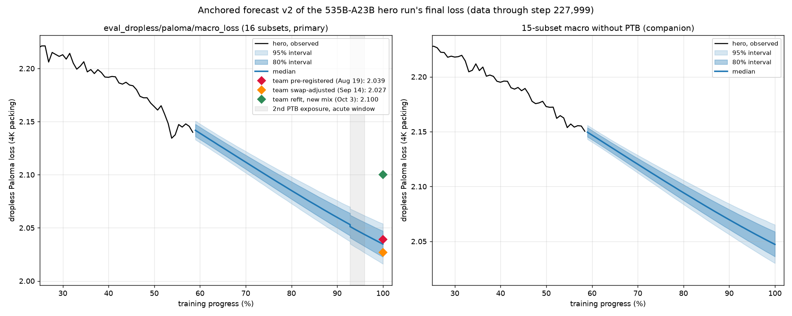

# Marin 535B-A23B hero run: an independent, pre-registered forecast of the final loss

This is an independent analysis, not affiliated with Marin or Open Athena. It uses only public data: the W&B project `marin-community/marin_moe` and the [marin-community/marin](https://github.com/marin-community/marin) GitHub repo. The hero run is tracked in [#8435](https://github.com/marin-community/marin/issues/8435).

**Current forecast: v2, frozen 2026-10-09** (data through step 227,999 of 390,251, i.e. 58.4%):

| Final eval, 4K eval packing | Median | 80% interval | 95% interval |
|---|---|---|---|
| `eval_dropless/paloma/macro_loss`, 16 subsets (primary) | **2.035** | **[2.023, 2.047]** | **[2.016, 2.054]** |
| 15-subset macro without PTB (companion) | 2.047 | [2.036, 2.059] | [2.030, 2.065] |

- The team's Aug 19 pre-registration (2.039) sits at our 68th percentile, and the Sep 14 swap-adjusted forecast (2.027) at our 20th.
- The Oct 3 refit (2.100) lies outside our distribution. The probability that the final value reaches 2.07 is 0.0002.

The targets, conditions, scoring rules, method, evidence and every change from v1 are in **[preregistration_v2.md](preregistration_v2.md)**.



## Versions
| Version | Tag | Primary median and 80% interval | Notes |
|---|---|---|---|
| **v2** (current, scored) | `prereg-v2-2026-10-09` | 2.035 [2.023, 2.047] | Same data as v1. The method was revised after a post-publication audit (see below). |
| v1 | `prereg-2026-10-09` | 2.045 [2.024, 2.058] | Kept unchanged: `05_preregistration.md`, `results/step5/`. |

What changed in v2:
- The drift prior and the d2048 extension are now set by backtests.
- The method error is pooled with the 67B-A2B run and has Student-t tails.
- A new allowance covers the method's drift toward pessimism at long extrapolation distances.
- The PTB allowance now applies from the second exposure dated in #9874, and the PTB level's uncertainty allows for autocorrelation.
- The primary target is now validated directly.

The bridge table in the pre-registration shows how much each change moves the forecast.

## Layout
| Path | Contents |
|---|---|
| `preregistration_v2.md` | The current pre-registration (v2), with the changes from v1 and errata for the v1 text |
| `05_preregistration.md` | The v1 pre-registration, unchanged |
| `code/forecast_v2.py` | v2 in one script: backtests, nested leave-one-out calibration, the forecast, sensitivity, the v1→v2 bridge, figures, and the hash manifest (`--hash-only`) |
| `code/` (other scripts) | The v1 pipeline, which v2 builds on: fetching the snapshot (`fetch_snapshot.py`), reproducing the team's forecasts (`reproduce.py`, `diagnose_floor.py`), exploration (`explore_step3.py`), the forecast (`forecast_step3.py`, `robustness_step3.py`, `perturbations_step4.py`) and the v1 freeze (`freeze_step5.py`) |
| `data/snapshot_2026-10-09T0440Z/` | The W&B metric table, run configs and `manifest.json` (SHA-256 of every file in the original snapshot) |
| `results/v2/` | The v2 frozen results and `freeze_manifest_v2.json` |
| `results/step5/` | The v1 frozen results and `freeze_manifest.json` |
| `results/step2_*`, `results/step3*`, `results/hero_actual.csv` | Reproduction of the team's forecasts and exploration, from an earlier snapshot (data through step 224,999) |

## Reproduce
```
pip install -r requirements.txt
cd code
python forecast_v2.py ../data/snapshot_2026-10-09T0440Z /tmp/v2
```
- The files in `/tmp/v2` should match `results/v2/` byte for byte; the hashes are in `results/v2/freeze_manifest_v2.json`. We checked this on macOS arm64 with the versions in `requirements.txt`. On other platforms the last digits of floating-point results can differ.
- v1: `python freeze_step5.py ../data/snapshot_2026-10-09T0440Z /tmp/v1`. v1's `robustness.json` comes from a separate run of `python robustness_step3.py ../data/snapshot_2026-10-09T0440Z <outdir>`.
- `check_snapshot.py` needs the full snapshot, which is not redistributed here, so it fails on this minimal data.
- To fetch a fresh snapshot, run `python code/fetch_snapshot.py --out data/<new>`. It reads W&B anonymously and uses the `gh` CLI for GitHub issues. GitHub issue texts and the tracker export are not redistributed here; their hashes are in the snapshot manifest.

## Method in one paragraph
- The scaling ladder is used only for *how much the loss will still fall* from now to the end.
- The level comes from the hero's own evals after the data swap ("anchoring").
- This makes the forecast almost independent of the irreducible-loss floor E, which a ladder of four small models cannot pin down.
- Monte Carlo combines the uncertainty from:
  - both ladders;
  - both compute conventions (with or without lm_head FLOPs);
  - an E range;
  - a backtested drift prior;
  - a backtested method error with Student-t tails;
  - an allowance for distance-dependent bias;
  - eval noise.
- PTB is modeled separately, because it is noisy and was contaminated (#9874).
- In nested leave-one-out calibration on held-out ladder rungs and the 67B-A2B run:
  - 80% intervals cover 14–15 of 16 cases;
  - 95% intervals cover all of them.

## Credits
- Data and fitting scripts by the Marin team.
- Method background: Porian et al. 2024, Besiroglu et al. 2024, Choshen et al. 2025, Tissue et al. 2024.
- Analysis by Qirun Li, with Claude (Anthropic) as a coding and analysis assistant.
