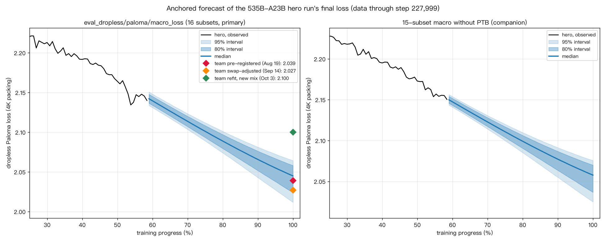

# Marin 535B-A23B hero run: an independent, pre-registered forecast of the final loss

This is an independent analysis, not affiliated with Marin or Open Athena. It uses only public data: the W&B project `marin-community/marin_moe` and the [marin-community/marin](https://github.com/marin-community/marin) GitHub repo. The hero run is tracked in [#8435](https://github.com/marin-community/marin/issues/8435).

**Forecast, frozen 2026-10-09** (data through step 227,999 of 390,251, i.e. 58.4%):

| Final eval, 4K eval packing | Median | 80% interval | 95% interval |
|---|---|---|---|
| `eval_dropless/paloma/macro_loss`, 16 subsets (primary) | **2.045** | **[2.024, 2.058]** | **[2.012, 2.064]** |
| 15-subset macro without PTB (companion) | 2.058 | [2.037, 2.070] | [2.025, 2.076] |

- The team's Aug 19 pre-registration (2.039) sits at our 32nd percentile.
- The Oct 3 refit (2.100) lies outside our distribution.

The targets, conditions, scoring rules, method and evidence are all in **[05_preregistration.md](05_preregistration.md)**.



## Layout
| Path | Contents |
|---|---|
| `05_preregistration.md` | The frozen pre-registration |
| `code/` | Every script, from fetching the snapshot (`fetch_snapshot.py`) through reproduction (`reproduce.py`, `diagnose_floor.py`), exploration (`explore_step3.py`), the forecast (`forecast_step3.py`, `robustness_step3.py`, `perturbations_step4.py`) to freezing (`freeze_step5.py`) |
| `data/snapshot_2026-10-09T0440Z/` | The W&B metric table, run configs and `manifest.json` (SHA-256 of every file in the original snapshot) |
| `results/step5/` | The frozen results: trajectories at 1% resolution, Monte Carlo samples, backtests, calibration, robustness, and `freeze_manifest.json` |
| `results/step2_*`, `results/step3*` | Reproduction of the team's forecasts, exploration experiments, and the step 3 run |

## Reproduce
```
pip install -r requirements.txt
cd code
python freeze_step5.py ../data/snapshot_2026-10-09T0440Z /tmp/out
```
`forecast_summary.json`, `trajectory_*.csv` and `end_samples.npz` in `/tmp/out` should match `results/step5/` byte for byte; the hashes are in `results/step5/freeze_manifest.json`.

To fetch a fresh snapshot, run `python code/fetch_snapshot.py --out data/<new>`. It reads W&B anonymously and uses the `gh` CLI for GitHub issues. GitHub issue texts and the tracker export are not redistributed here; their hashes are in the snapshot manifest.

## Method in one paragraph
- The scaling ladder is used only for *how much the loss will still fall* from now to the end.
- The level comes from the hero's own post-swap evals ("anchoring").
- This makes the forecast almost independent of the irreducible-loss floor E, which a ladder of four small models cannot pin down.
- Uncertainty from both ladders, both compute conventions (with or without lm_head FLOPs), an E range, drift persistence, a backtested method error and eval noise is combined by Monte Carlo.
- PTB is modeled separately because it is noisy and was contaminated (#9874).
- Leave-one-out calibration on held-out ladder rungs and the 67B-A2B run gives 79–83% coverage for the 80% intervals.

## Credits
- Data and fitting scripts by the Marin team.
- Method background: Porian et al. 2024, Besiroglu et al. 2024, Choshen et al. 2025, Tissue et al. 2024.
- Analysis by Qirun Li, with Claude (Anthropic) as a coding and analysis assistant.
