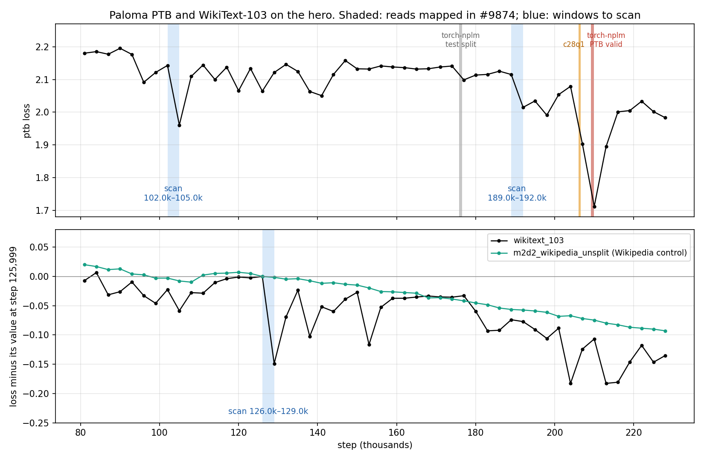

# Eval audit: PTB and WikiText-103 drops on the hero, and a decon recall test

This is an independent analysis, not affiliated with Marin or Open Athena. It uses the same public W&B snapshot as the forecast (`../data/snapshot_2026-10-09T0440Z`, evals through step 227,999), public GitHub files, and the public Stack v3 dataset. It does not change the frozen forecast.

## Findings
1. **Noise attribution.** After the 108k mix swap, PTB accounts for 50–68% of the variance in the Paloma macro's eval-to-eval movement, and WikiText-103 for 19–27%. The range covers three detrending methods; the block-bootstrap 95% CI for PTB is 0.33–0.85. Dropping both subsets cuts the macro's noise SD to 43–61% of its current value. The 7 Uncheatable subsets show no drop events at z = 4, 5 or 6.
2. **PTB drops not explained by the reads mapped in marin#9874.** At 104,999, PTB sits 0.165 below the average of its two neighbours (2.143 → 1.961 → 2.109); there is no mapped read nearby. At 191,999 it drops 0.10 and stays below 2.08 through 227,999. The 176,080–176,355 read, which has only PTB test text, moves the eval by 0.029.
3. **WikiText-103 drops that general Wikipedia doesn't show.** At 128,999, wikitext_103 falls 0.149 from the previous eval while `m2d2_wikipedia_unsplit` falls 0.0015. Smaller one-sided drops recur at 137,999, 152,999, 203,999 and 212,999–215,999.
4. **Decon recall on the torch-nplm document.** We indexed Paloma PTB, which the real eval corpus doesn't include. Marin's matcher, run unchanged with the production settings, scores the trained document (PTB validation set as 6-word sliding windows) at overlap 0.000. The same repo with the raw `valid.txt` scores 1.000. Windows of any width from 3 to 30 stay at or below 0.144. A de-windowing pre-pass, which stitches shift-by-one lines back into text, recovers 1.000. In 5,724 ordinary files it triggered on 0 of 241,449 paragraphs.
5. **Stack v3 census.** We scanned all 8,192 parquet files of `HuggingFaceCode/stack-v3-train` at `1f61b735` (v3.1, 172.8M repos). Marin's pinned `bb2fa950` returns 403 since the dataset history was squashed on 2026-09-25. v3.1 differs from it by opted-out repos and by the duplicate file entries that `deduplicate_files` already drops (marin#7788). The 529 files whose path or size looks like PTB or WikiText data were scored by 13-gram overlap with PTB and WikiText-103 valid/test, as written and de-windowed.
   - PTB valid and test: the only copies are torch-nplm's `valid.6grams` and `test.6grams`, with 0.988 and 0.987 of the eval 13-grams after de-windowing. No raw or tokenized copy of either validation set was found.
   - WikiText-103 valid: no file holds more than 2.4% of its 13-grams. Paloma's `wikitext_103` val, which Marin evaluates on, is this split: it contains 98% of validation's 13-grams and none of test's.
   - WikiText-103 test: `shaochenze/PatchTrain` `wikitext_document_level-test.json` matches 0.699 as written. The GitHub file decodes to the full test set, all 62 articles. That is also the test set of lm-eval's `wikitext` task, which `DECON_EXCLUDED_EVAL_TASKS` leaves out of decon.
   - Limits: a copy under an unrelated file name would be missed, and repos that opted out before v3.1 can't be checked.



## Layout
| Path | Contents |
|---|---|
| `code/analyze_eval_events.py` | Noise attribution, the pre-specified event detector, and the post-hoc two-sided spike statistic. Writes `results/phase1/` |
| `code/post_9874_figure.py` | The quoted eval values (`numbers_9874.json`) and the figure. Writes `results/post/` |
| `code/decon_recall_windowed.py` | Loads the matching functions of Marin's `decon.py` from a checkout, unmodified, and runs the recall test and the de-windowing prototype. Writes `results/decon/` |
| `code/stackv3_eval_copy_scan.py` | The Stack v3 scan: a path/size prefilter over every file, then 13-gram scoring as written and de-windowed. Writes `results/stackv3/`; `stage_b_scored.csv` lists every prefiltered file with its scores |
| `code/verify_patchtrain_copy.py` | Decodes PatchTrain's JSON and compares it with WikiText-103 raw test. Writes `results/stackv3/patchtrain_check.json` |
| `code/check_paloma_wikitext_split.py` | Decodes Paloma's `wikitext_103` val from an ungated token mirror and matches it against WikiText-103 validation and test. Writes `results/stackv3/paloma_wikitext_split.json` |
| `code/fetch_inputs.sh` | Fetches the third-party inputs, pinned to commits where the host allows it: torch-nplm, an independent PTB copy, a Marin checkout, the PatchTrain file, WikiText-103 raw validation and test (Hugging Face's auto-converted parquet), Paloma's `wikitext_103` val tokens from an ungated mirror, and the GPT-NeoX tokenizer. They are not redistributed here. The result JSONs record the SHA-256 of the files they read |

## Reproduce
```
pip install -r ../requirements.txt
cd code
python analyze_eval_events.py ../../data/snapshot_2026-10-09T0440Z /tmp/phase1
python post_9874_figure.py ../../data/snapshot_2026-10-09T0440Z /tmp/post
sh fetch_inputs.sh ../inputs
python3.12 -I decon_recall_windowed.py ../inputs/marin ../inputs/torch-nplm ../inputs/wojzaremba-lstm/ptb.valid.txt /tmp/decon \
    ../inputs/marin "$(python3.12 -c 'import sysconfig; print(sysconfig.get_paths()["stdlib"])')"
python stackv3_eval_copy_scan.py --out /tmp/stackv3 --workers 128
python -I verify_patchtrain_copy.py ../inputs/patchtrain/wikitext_document_level-test.json \
    ../inputs/wikitext-103-raw-v1-test/0.parquet /tmp/patchtrain_check.json
python -I check_paloma_wikitext_split.py ../inputs/paloma-wikitext-val/val.tar ../inputs/gpt-neox-20b/tokenizer.json \
    ../inputs/wikitext-103-raw-v1-validation/0.parquet ../inputs/wikitext-103-raw-v1-test/0.parquet /tmp/paloma_wikitext_split.json
```
- The decon test needs Python 3.10 or later and nothing outside the standard library.
- The Stack v3 scan and the two checks need `pyarrow` and `requests`; the Paloma split check also needs `tokenizers`. The scan reads the path and size columns of every file (about 46 GB), then the content of the 246 row groups that hold candidates; on a Google Colab CPU runtime it took 3 hours. The published results come from this script; only the runtime note in its docstring was edited after the run.
- The trailing arguments are the directories used as the negative control for the de-windowing pass. The timings in `decon_recall_windowed.json` depend on the machine.
- `decon.py` at Marin commit `3c62e65f8f` has SHA-256 `a6ef1ed28f95d72259fa5a16540b4fdf5f82546785c20da16ea8963130f626cb`. The torch-nplm `valid.txt` is byte-identical to `ptb.valid.txt` in wojzaremba/lstm.
